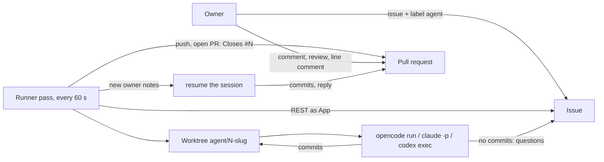
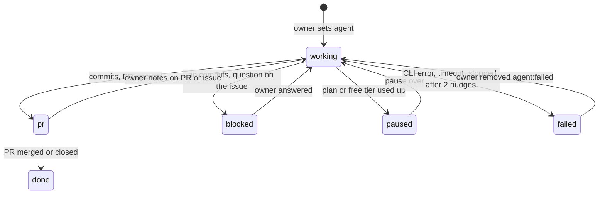

# famulus spec

Stage: MVP. The owner accepts pull requests by hand. Acceptance gates, scores and a journal
come later (admitd vision, stage 2 "own farm").

## Contents

1. What it is
2. Flow
3. States
4. Parts
5. Agents
6. Boundaries
7. Scenarios
8. Decisions
9. Out of scope

## 1. What it is

A Docker container on the owner's machine. One process polls the watched GitHub
repositories every minute. An issue with the label `agent` goes to a coding agent: OpenCode,
Claude Code or Codex. The agent commits on a branch. The runner pushes the branch and opens
a pull request as a GitHub App bot. Later notes of the owner on the pull request or the issue
go back to the same agent session. When the agent lacks something, it asks in a comment.

Not: a GitHub Action, a hosted service, an auto-merger, a queue for several users.

Name: famulus (a scholar's assistant), checked 2026-10-28; GitHub App `famulus-agent`, because
the account `famulus` exists. Trademarks and domains not checked.

Prior art rechecked on 2026-10-28 (`docs/research/cloud-coding-agents.md`). Close ones:
AgentConnect (ACP, App bot, PR feedback resumes the author session, but GitHub only by webhook
and four services), propr (label, Docker, subscriptions, but a new session per comment),
OpenHands Agent Canvas (Claude Code and Codex over ACP, issue-to-PR automation, but the user's
token as identity), optio and kelos (Kubernetes). Noctra, DevIntern and Shikumi claim polling
with both CLIs, checked from READMEs only. None found polls without a public URL, posts as a
bot and resumes the same session in one small binary; that is why famulus stays its own.

## 2. Flow

One pass, per repository:

1. Every task in state `pr`: a merged or closed PR finishes the task (`done`, worktree
   removed). New owner notes on the PR or the issue resume the session.
2. Open issues with the label `agent`. A new one starts: label `agent:working`, worktree from
   the fresh base branch, first prompt = agent rules + issue + owner comments. At most
   `daily_limit` (default 5) new issues start per UTC day; the rest wait with the label `agent`
   alone. Retries, answers and PR notes do not count.
3. A `blocked` issue resumes when the owner wrote after the agent's question.
4. After a run: changes the agent left uncommitted are committed by the runner; new commits
   are pushed; the final message becomes the PR description (first PR), a reply on the PR,
   or a comment on the issue when there are no commits (state `blocked`).
5. Before a PR exists, a run with no commits and no `## Questions` heading is unfinished: the
   runner sends the same session a nudge, up to 2 times, then the task fails.

## 3. States

The issue label `agent:<state>` mirrors the task state, so the owner sees it on GitHub.

A used-up plan is not a failure: the runner rests that agent until the time the provider
named, else for `limit_pause` (1 hour), comments once on the issue with the retry time and
retries by itself. While an agent rests, its other issues wait in the queue without comments.
Limits of the free OpenCode Zen models are not published (checked 2026-10-25); a used-up free
tier answers HTTP 429 `FreeUsageLimitError`, error type `provider.free-limit`.

`state.json` on the work volume keeps what GitHub does not: agent, session, branch, PR
number, `since` (the creation time of the newest owner note already given to the agent), the
pause end of each agent and the count of new issues started on the current UTC day.

## 4. Parts

| Part | Role |
|---|---|
| `internal/config` | `famulus.toml`: owner, label, interval, timeout, agents, repositories |
| `internal/github` | REST client as GitHub App: JWT, installation tokens, issues, labels, notes, PRs |
| `internal/workspace` | one clone per repository, one worktree per issue, push without force |
| `internal/agent` | the three CLIs behind one call: prompt and session in, session and final message out |
| `internal/state` | `state.json`, written through a temporary file |
| `internal/yard` | the pass, state changes, prompts |
| `internal/panel` | read-only admin page on `panel` (default `:8080`): health, tasks from `state.json`, last log lines |
| `rules/AGENTS.md` | rules every first prompt starts with |

## 5. Agents

| Agent | New run | Resume | Login |
|---|---|---|---|
| OpenCode | `opencode run --format json --model M` | `--session ID` | free Zen models need none |
| Claude Code | `claude -p --output-format json --dangerously-skip-permissions` | `--resume ID` | `CLAUDE_CODE_OAUTH_TOKEN` from `claude setup-token` |
| Codex | `codex exec --json --dangerously-bypass-approvals-and-sandbox -o FILE -` | `codex exec resume ID` | `codex login --device-auth` once, inside the container |

The container is the sandbox, so the permission bypass flags are allowed inside it. The
agent's environment has no `FAMULUS_*` variables: it never sees the App key and cannot
push. A resume that fails starts a new session with the rules and a summary of the task.

## 6. Boundaries

What the runner does not do on any input:

- R1. Takes only issues with the label `agent`; on GitHub only people with triage rights
  can set labels.
- R2. Passes to the agent only notes written by `owner`. A stranger's comment never reaches a
  prompt.
- R3. Never merges, never pushes to the base branch, never force-pushes.
- R4. One agent at a time; a run is cut at `timeout`.
- R5. Gives the agent no GitHub token and no App key.

## 7. Scenarios

| ID | Given | Expect |
|---|---|---|
| S1 | issue labeled `agent`, agent commits | branch pushed, PR `Closes #N`, label `agent:pr` |
| S2 | agent makes no commits | its message is an issue comment, label `agent:blocked` |
| S3 | blocked issue, owner answers | same session resumed with the answer |
| S4 | owner review or line comment on the PR | same session resumed, new commits pushed, reply on the PR |
| S5 | stranger comments | nothing reaches the agent (R2) |
| S6 | PR merged or closed | task `done`, worktree removed |
| S7 | agent CLI fails | comment with the cause, label `agent:failed`; removing the label retries |
| S8 | resume fails (session lost) | new session with rules and task summary |
| S9 | agent leaves changes uncommitted | runner commits them, they reach the PR |
| S10 | container stops mid-run | no failure is recorded; the task restarts on the next start |
| S11 | agent reports a used-up plan, also only in the OpenCode error log while the CLI waits | label `agent:paused`, one comment with the retry time, automatic retry |
| S12 | agent ends its turn with no commits and no questions | same session nudged up to 2 times; still nothing - `agent:failed` with a comment |
| S13 | `daily_limit` new issues already started today | further new issues wait untouched until the next UTC day; owner notes on open PRs still run |

## 8. Decisions

- Own poller instead of claude-code-action: polling needs no public URL, one runner serves
  all repositories, any CLI with a subscription works.
- GitHub App bot instead of the owner's token: the owner can review the bot's PRs formally,
  and the bot's comments are told apart by author.
- The runner, not the agent, pushes and opens the PR: deterministic, and the agent holds
  no credentials.
- Rules travel in the prompt, not in files in the image: the same text for all three CLIs.
- simplified: one agent at a time and the first 100 issues and notes per call; revisit with
  parallel agents.

## 9. Out of scope

Acceptance gates and scores of admitd, parallel agents, tasks from tix, notifications, a web
panel, Linux builds of macOS-only projects (tarn's Swift part does not build in the container).
